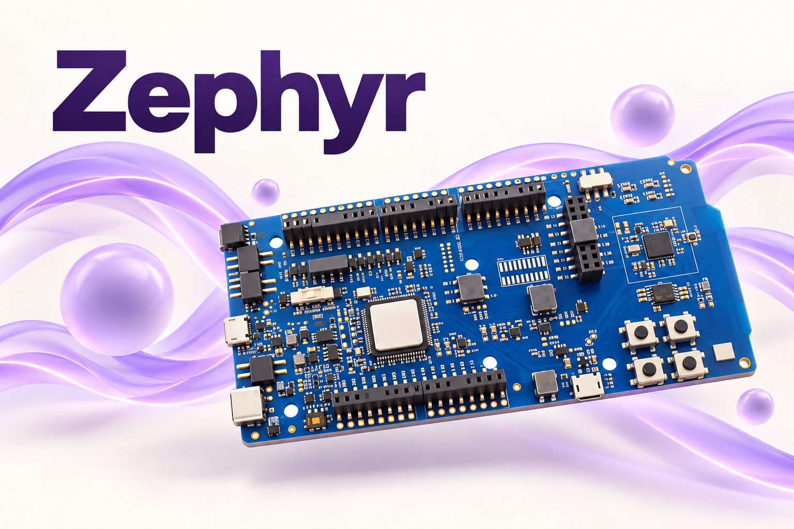
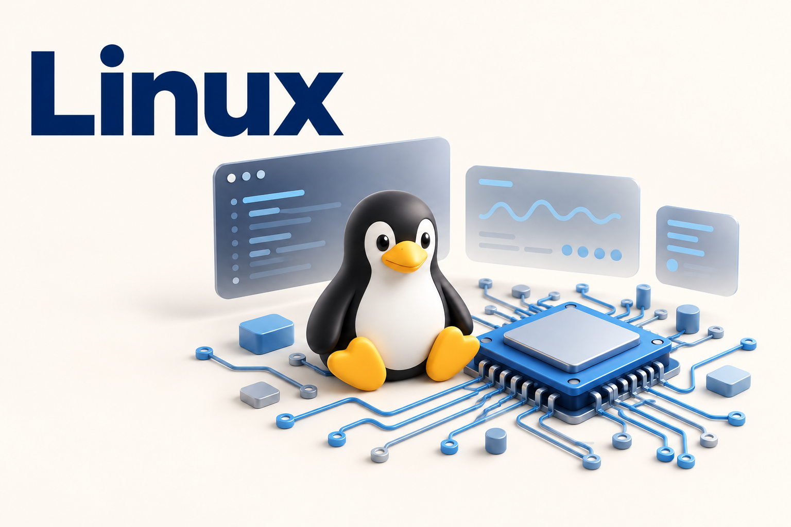
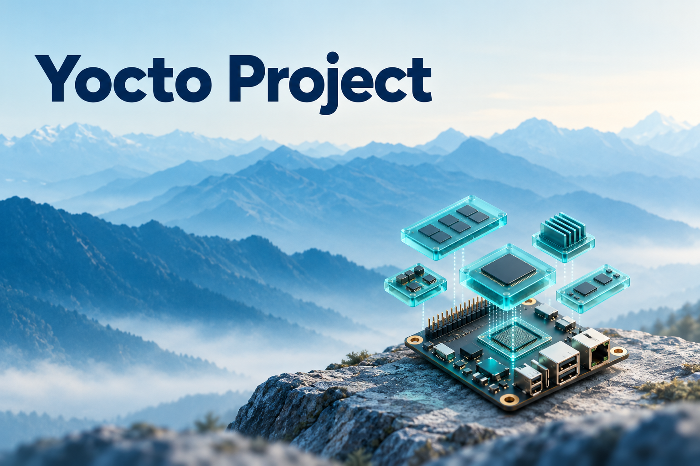

进程使命 · 开源社区

<h1>Mission Forge Contributor Program（MFCP）</h1>

  <strong>学习 · 实践 · 贡献 · 成长</strong> 
  进程使命开源贡献者成长计划，通过真实开源贡献积累工程经验。

  
  
  
  

<a href="README.md">English</a> · <strong>简体中文</strong>

  <a href="docs/program.md">开始参与</a> ·
  <a href="projects/README.md">探索项目</a> ·
  <a href="programs/2026/README.md">2026 年培养安排</a> ·
  <a href="CONTRIBUTING.md">贡献指南</a>

---

MFCP 由<strong>进程使命（Process Mission）</strong>发起，通过开源学习、导师指导、真实项目实践和贡献评估，帮助参与者积累工程经验。

本仓库管理参与规则、项目资料、培养记录和贡献追踪。代码贡献提交到对应项目的上游仓库。配套指南目前使用中文。

## 探索实践项目

选择感兴趣的项目，通过实际贡献积累工程经验。

<table width="100%">
  <tr>
    <td width="50%" valign="middle">
      <h3><a href="projects/zephyr/README.md">Zephyr</a></h3>
      
<strong>动手开发实时嵌入式系统。</strong>

      
探索板级支持、设备驱动与示例，在嵌入式平台上验证运行结果，完善测试与文档。

      
<a href="projects/zephyr/README.md">探索 Zephyr →</a>

    </td>
    <td width="50%" align="center" valign="middle">
      
    </td>
  </tr>
  <tr>
    <td width="50%" align="center" valign="middle">
      
    </td>
    <td width="50%" valign="middle">
      <h3><a href="projects/linux/README.md">Linux</a></h3>
      
<strong>通过实践理解内核。</strong>

      
分析实际问题，参与驱动开发，完善测试与文档，并按照内核社区的流程参与评审。

      
<a href="projects/linux/README.md">探索 Linux →</a>

    </td>
  </tr>
  <tr>
    <td width="50%" valign="middle">
      <h3><a href="projects/yocto/README.md">Yocto Project</a></h3>
      
<strong>构建自己的嵌入式 Linux 系统。</strong>

      
编写配方、组织软件层、生成系统镜像，并针对目标平台验证构建结果。

      
<a href="projects/yocto/README.md">探索 Yocto Project →</a>

    </td>
    <td width="50%" align="center" valign="middle">
      
    </td>
  </tr>
</table>

## 开始参与贡献

1. **了解培养规则。** 阅读[参与规则](docs/program.md)和[贡献指南](CONTRIBUTING.md)。
2. **选择实践项目。** 阅读项目资料，查看 [2026 年培养安排](programs/2026/README.md)。
3. **确认实践任务。** 通过本仓库 Issue 提出任务或申请参与已发布任务，与导师确认范围和验收条件。
4. **完成实践并提交证据。** 记录实际验证结果，提供上游贡献链接，参与评审与成果评估。

**2026 年状态：** 招募公告尚未发布。具体时间、导师、任务和激励安排将在[年度培养安排](programs/2026/README.md)中公布。

## 通过实践成长

| 培养内容 | 文档说明 |
| --- | --- |
| [贡献者等级](docs/levels.md) | L0–L4 的能力描述与晋升依据 |
| [贡献评估](docs/assessment.md) | 工程质量、验证、协作与成果价值的评估标准 |
| [导师指导](docs/mentorship.md) | 导师和参与者的职责、沟通与协调安排 |
| [津贴与奖励](docs/stipends.md) | 激励公告及发放条件的说明要求 |

## 查找仓库资料

| 目录 | 内容 |
| --- | --- |
| [`docs/`](docs/program.md) | 参与规则、贡献者等级、评估标准、激励规则与导师机制 |
| [`projects/`](projects/README.md) | 各项目长期使用的学习资料与实践指南 |
| [`programs/`](programs/README.md) | 历年培养公告、阶段评估与贡献记录 |

目录组织参考 [CNCF Mentoring](https://github.com/cncf/mentoring)，在主仓库内维护培养机制与历年记录。
